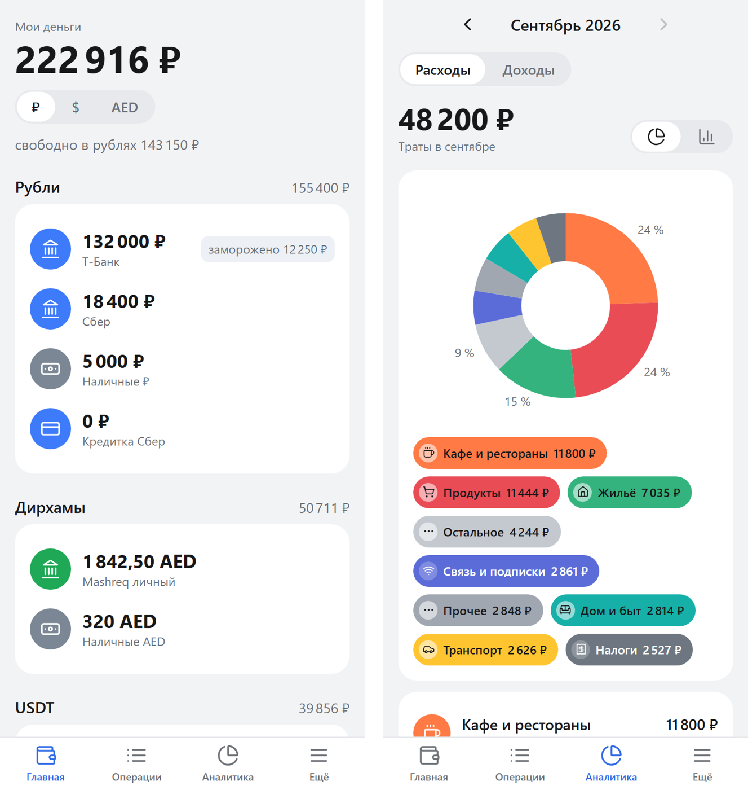

# Finuchet — personal finance by voice, with real double-entry accounting

A Telegram bot plus a Telegram Mini App for tracking personal money across rubles, dirhams and USDT.
You send a voice note ("had lunch for 43 dirhams", "moved 50k rubles to Bybit, got 500 USDT"), the bot
turns it into a balanced journal entry, and the mini app shows balances, analytics, debts, goals and limits.
Built for my own use: I live in Dubai and get paid in two currencies, and every spreadsheet I tried drifted.



## What it does

- **Voice, text, screenshots, PDF statements in.** Speech-to-text (OpenAI / Groq / Telegram Premium via Telethon),
  then an LLM parses the phrase into a strict JSON schema: kind, amount, currency, accounts, category, date.
  Missing amount or currency — one short follow-up question, not a form.
- **Double-entry ledger.** Every operation is a set of postings that sum to zero per currency, so balances
  never "float" and the monthly total always matches the journal. Cancel = storno, not delete.
- **Multi-currency.** RUB, AED, USDT, with the rate stored at the moment of the operation (Bybit P2P rate
  with a fallback). Display currency switch on the home screen does not touch the books.
- **Family money.** Taking dirhams from a shared family account creates a debt to the family and freezes
  the ruble equivalent on a personal account, so "my money" stays honest.
- **Bank reconciliation.** Send a screenshot or PDF statement — the bot matches lines with the journal,
  shows what is missing and offers to add it or align the balance.
- **Mini app.** Home, operations feed with filters, analytics (month donut, 12-month bars, income sources),
  debts, payment calendar, goals, limits, XLSX export. Light and dark themes.

## How it is built

```
Telegram voice/text/photo ──► bot (aiogram) ──► STT ──► LLM parser ──► pipeline ──► ledger (SQLite)
                                                                                     ▲
Telegram Mini App (React + Vite + Tailwind) ──► FastAPI (initData HMAC auth) ────────┘
```

- `backend/ledger` — accounts, postings, balances, goals, limits, reconciliation, the savings jar.
- `backend/pipeline` — voice/text/screenshot/statement → validated entry; `backend/prompts` — schemas and prompts.
- `backend/stt`, `backend/rates` — pluggable speech-to-text and exchange-rate providers.
- `backend/api` — FastAPI routes for the mini app; access only for `OWNER_TG_ID`, verified via Telegram initData.
- `frontend` — React + TypeScript mini app; runs on mock data with `VITE_USE_MOCKS=1`.
- `tests`, `tests_bot` — 270+ pytest tests, including adversarial ones for the ledger invariants.

## Run it

```bash
cp .env.example .env            # fill BOT_TOKEN, OWNER_TG_ID, an LLM key and an STT key
python -m venv .venv && . .venv/bin/activate
pip install -r backend/requirements.txt -r backend/requirements-bot.txt
cd frontend && npm install && npm run build && cd ..
python -m uvicorn backend.app:app --port 8080
pytest -q                       # ledger and API tests
```

Or with Docker: `docker build -t finuchet . && docker run -p 8080:8080 --env-file .env -v $PWD/data:/data finuchet`.
Point the bot's menu button (BotFather → Mini App) to `PUBLIC_URL`.

Code comments and UI are in Russian — the app was built for a Russian-speaking user.

## License

MIT
